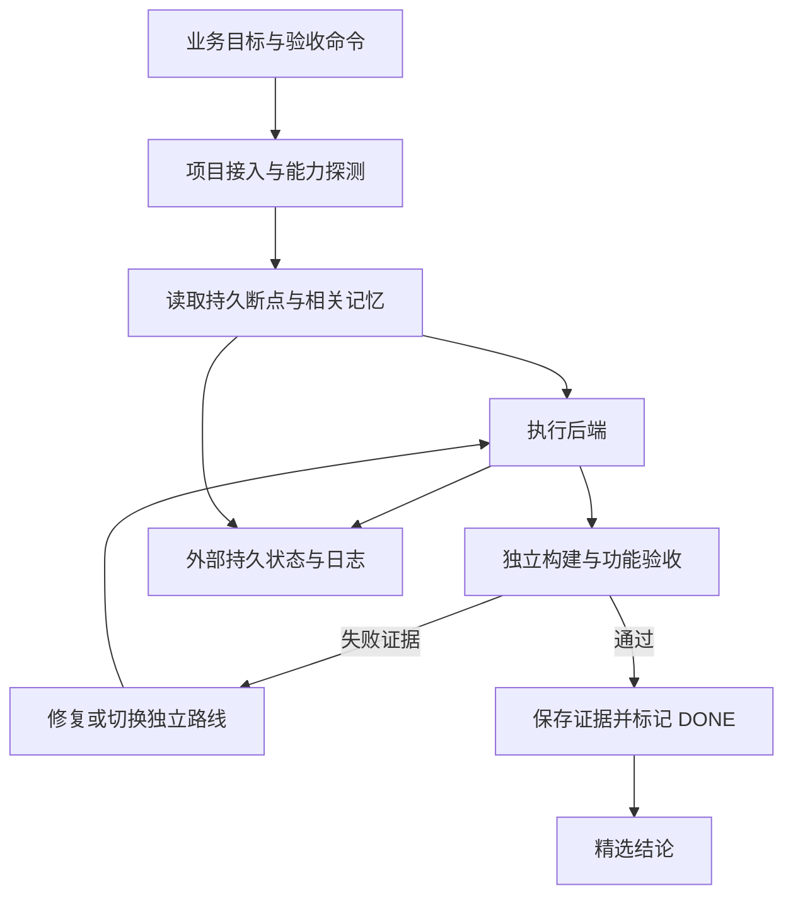

# 架构与数据流

CodexCloudKit 将可重复部署的共享工具、项目接入、精选记忆和可恢复执行分成独立层。业务代码与依赖锁仍属于业务仓库。

## 存储职责

| 存储层 | 内容 | 生命周期 |
| --- | --- | --- |
| 源码发行仓库 | CLI、安装入口、通用规则、合成示例与文档 | Git 版本化 |
| 共享运行目录 | 已安装工具、技能和安装收据 | 可由固定发行版重新准备 |
| 项目工作目录 | 应用源码、项目锁和项目自己的规则 | 项目自行版本化 |
| 外部状态目录 | 任务断点、租约、日志、精选记忆、快照 | 持久磁盘或私有远端保存 |
| 派生索引 | 内容哈希、文件清单和可重建检索数据 | 随版本指纹定向更新 |

项目身份、分支和源版本用于区分状态。切换项目后重新启动项目绑定的工具进程。公开源码的 Git 分支不承载真实业务记忆或运行日志。

## 执行与验收

后端负责执行任务，验收命令负责判断结果。后端返回成功后仍运行验收；失败结果带着实际日志进入下一轮修复。持续执行依赖可工作的后端进程、认证、持久状态和定期唤醒路径。

调度器在执行前持久化租约和断点；完成后记录输出与验收证据。重复事件恢复既有任务，已通过的步骤不因进程重启自动重复执行。遇到重复错误或连续无进展时，当前路线熔断并选择适用备用路线。
